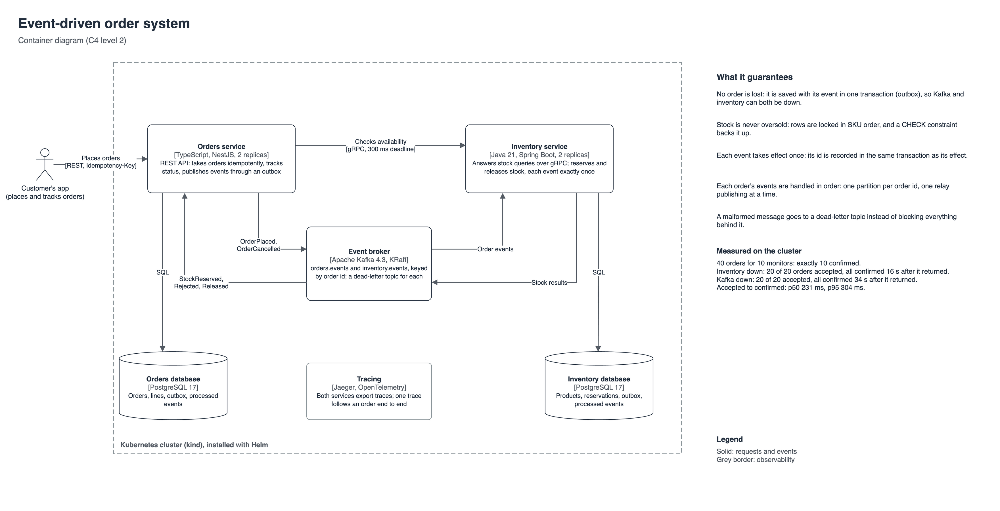
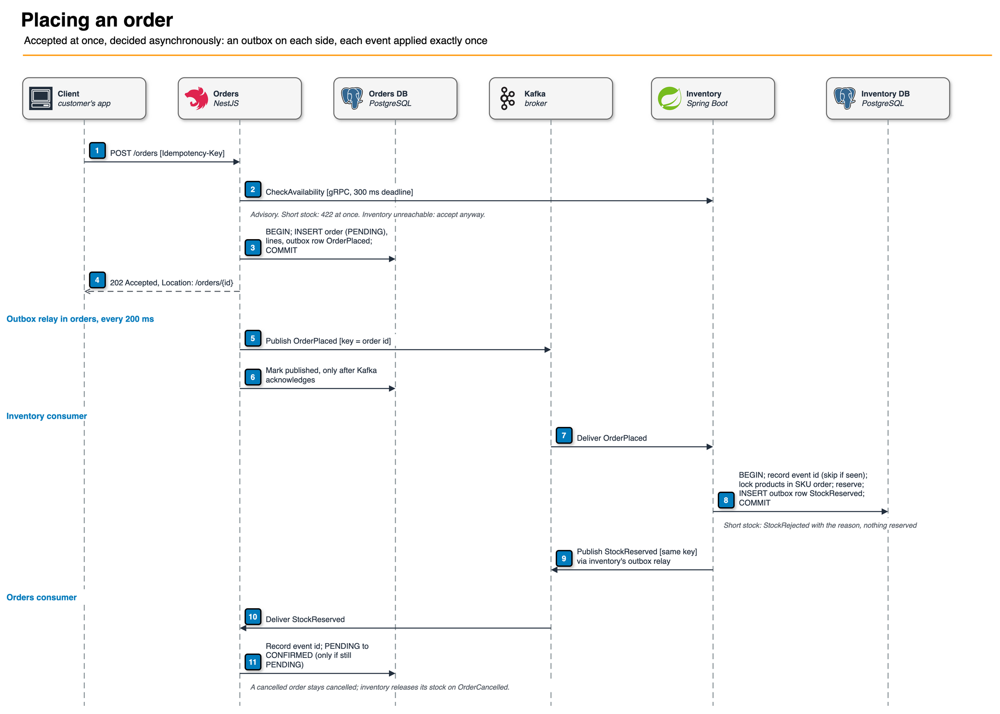

# Event-driven order system

[](https://github.com/tapiwa-magumise/event-driven-orders/actions/workflows/ci.yml)

Two microservices that take and fulfil orders through events, built to keep working when parts of the system fail. An order is never lost, even with the event broker or the inventory service down; stock is never oversold under concurrent load; and every event takes effect exactly once, in order.

- Orders service: TypeScript, NestJS, PostgreSQL
- Inventory service: Java 21, Spring Boot, PostgreSQL
- Between them: Apache Kafka for events, gRPC for queries
- Platform: Kubernetes (kind) with Helm, OpenTelemetry tracing to Jaeger, CI on GitHub Actions



## Measured results

All from [`scripts/e2e.mjs`](scripts/e2e.mjs) on a three-node kind cluster, two replicas of each service. CI runs the same checks on every push.

| What | Result |
|---|---|
| 40 orders race for 10 monitors | exactly **10** confirmed, stock left 0 |
| Inventory scaled to zero, 20 orders placed | **20 of 20** accepted, all confirmed 15 s after it returned |
| Kafka scaled to zero, 20 orders placed | **20 of 20** accepted, all confirmed 34 s after it returned |
| 10 concurrent retries with one idempotency key | **1** order |
| Malformed message | moved to a dead-letter topic; the next order still confirmed |
| Accepted to confirmed, 100 orders | p50 **232 ms**, p95 **360 ms** |
| Tests | 12 Java (Testcontainers: real Kafka and PostgreSQL), 20 TypeScript (real PostgreSQL) |

Details and caveats: [`docs/e2e-results.md`](docs/e2e-results.md).

## How an order flows



1. `POST /orders` with an `Idempotency-Key`. Orders asks inventory over gRPC whether the stock exists (300 ms deadline, advisory).
2. In one transaction, orders saves the order as `PENDING` and an `OrderPlaced` event in its outbox, then replies `202 Accepted`.
3. A relay publishes the event to Kafka, keyed by order id.
4. Inventory consumes it and, in one transaction, records the event id, locks the products, reserves the stock and writes `StockReserved` (or `StockRejected` with the reason) to its own outbox.
5. Orders consumes the result and moves the order to `CONFIRMED` or `REJECTED`.

Cancelling sends `OrderCancelled` down the same path, and inventory releases the stock. One trace follows the whole thing across both services:


## API

| Method | Path | Purpose |
|---|---|---|
| POST | `/orders` | Place an order (requires `Idempotency-Key`). 202 accepted, 200 replayed, 409 key reused for a different order, 422 not enough stock |
| GET | `/orders/{id}` | Order with its status and, if rejected, the reason |
| POST | `/orders/{id}/cancel` | Cancel a pending or confirmed order |
| GET | `/products` | Catalogue with available stock, from inventory over gRPC |
| GET | `/healthz`, `/readyz`, `/metrics` | Liveness, readiness, Prometheus metrics |

The gRPC contract is [`proto/inventory/v1/inventory.proto`](proto/inventory/v1/inventory.proto).

## Running it

Needs Docker, kind, Helm, kubectl and Node 24.

```bash
scripts/up.sh             # build images, create the cluster, install the charts
node scripts/e2e.mjs      # the checks above, including the outage drills
```

| Service | URL |
|---|---|
| Orders API | http://localhost:8090 |
| Jaeger | http://localhost:16688 |

```bash
curl -s -X POST localhost:8090/orders -H 'content-type: application/json' \
  -H "idempotency-key: $(uuidgen)" -d '{"customerId":"c1","lines":[{"sku":"KB-001","quantity":1}]}'
```

For development without Kubernetes, `docker compose up` runs the same images with Kafka, both databases and Jaeger.

## Tests

```bash
cd inventory && ./mvnw verify                                       # starts Kafka and PostgreSQL with Testcontainers
docker compose up -d orders-db && cd orders && npm ci && npm test   # real PostgreSQL
```

## Repository

| Path | What it is |
|---|---|
| [`orders`](orders) | NestJS service: REST API, outbox relay, Kafka consumer, gRPC client |
| [`inventory`](inventory) | Spring Boot service: gRPC server, Kafka listener, reservations, outbox relay |
| [`proto`](proto) | The gRPC contract both services build from |
| [`charts/service`](charts/service) | One Helm chart for both services: Deployment, Service, PDB, NetworkPolicy |
| [`charts/platform`](charts/platform) | Kafka (KRaft), one PostgreSQL per service, Jaeger |
| [`scripts`](scripts) | Cluster set-up and the end-to-end checks |
| [`docs`](docs) | Diagrams, decisions, results |

See [docs/decisions.md](docs/decisions.md) for why each choice was made and what production would add.
