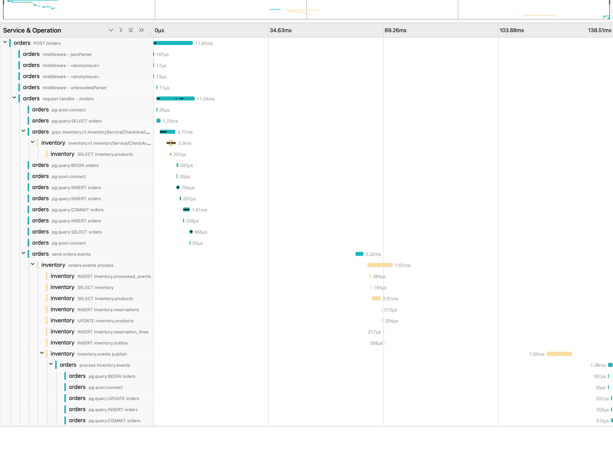

# End-to-end results

Run on 16 October 2026, on a freshly created cluster, with [`scripts/e2e.mjs`](../scripts/e2e.mjs) against a local kind cluster: one control-plane node and two workers, two replicas each of the orders and inventory services spread across the workers, a single Kafka 4.3.1 broker (KRaft) and one PostgreSQL 17 per service. Docker had 10 CPUs and 7.7 GB of memory. CI runs the same script on every push.

All 13 checks passed.

| Check | Result |
|---|---|
| Catalogue served over gRPC | 5 products |
| 100 orders, 10 at a time, after 10 unmeasured warm-up orders | 100 confirmed |
| Time from accepted (202) to confirmed | p50 232 ms, p95 360 ms, max 373 ms |
| 40 orders race for 10 monitors | exactly 10 confirmed, 30 rejected, stock left 0 |
| 10 concurrent retries with one idempotency key | 1 order |
| Cancel a confirmed order | available stock 11, then back to 15 |
| Malformed message on `orders.events` | moved to `orders.events.DLT`; the next order was still confirmed |
| Inventory scaled to zero, 20 orders placed | 20 of 20 accepted |
| Inventory scaled back up | all 20 confirmed 15 s later, including JVM start-up |
| Kafka scaled to zero, 20 orders placed | 20 of 20 accepted |
| Kafka scaled back up | all 20 confirmed 34 s later |
| Orders left pending at the end | 0 |
| Products over-reserved or negative | 0 |

**On GitHub Actions** (a smaller shared runner), the same script on a fresh cluster also passed 13 of 13: p50 257 ms, p95 387 ms; all orders confirmed 31 s after inventory returned and 52 s after Kafka returned. The correctness results were identical; only the timings differ.

## What the numbers mean

**Where the time goes.** In the trace below, the request itself takes 12 ms, including the gRPC availability check (4.8 ms) and the transaction that writes the order and its event, and the order is confirmed 138 ms after it arrived. Nearly all of the gap is waiting: two outbox relays, one in each service, each poll every 200 ms. The end-to-end figures above are a little higher because the test also polls for the result every 100 ms. The poll interval is a setting: lower means faster confirmation and more idle database queries.

**No overselling.** All 40 orders passed the gRPC pre-check, because they arrived together while 10 monitors were still free. The pre-check is advisory. The reservation is the decision: inventory locks the product rows and a `CHECK (reserved <= on_hand)` constraint backs it up, so exactly 10 succeeded.

**Outages.** Orders are written to the database with their event in one transaction, so neither Kafka nor inventory has to be up to accept one. When inventory was down, the 300 ms gRPC deadline expired, the pre-check was skipped, and orders were accepted as PENDING. Once each dependency came back, the outbox relay and the consumers caught up with nothing lost and nothing applied twice. Kafka took longer to recover because the broker restarts, then consumer groups rejoin, then the backlog drains.

**gRPC load balancing.** gRPC keeps a long-lived connection, so a normal Kubernetes Service would pin every call from one orders pod to one inventory pod. Through a headless Service with round-robin balancing in the client, the two inventory pods handled 70 and 82 availability checks in one run.

**Network policy.** The cluster enforces it. A pod without the `orders` label could not reach inventory's gRPC port, and the inventory service could not connect to the orders database. Inventory's HTTP port (health and metrics) stays open inside the cluster.

## What earlier runs caught

- Jaeger was OOM-killed. The first local run passed all 13 checks, but afterwards the traces were missing. Jaeger's in-memory store has no limit by default, and the run pushed it past its 384 MiB limit. It now keeps at most 20,000 traces in 512 MiB.
- The first gRPC calls after a deploy failed. The first CI run passed 12 of 13 checks: `GET /products`, called seconds after the cluster came up, returned 503. The orders service only opened its gRPC connection on the first request, and setting it up took longer than the 300 ms deadline. Orders placed at that moment were still accepted, because the check is advisory, but the catalogue was not served. The service now connects at start-up, and on a fresh cluster `/products` returned 200 straight after deployment.
- Cold start skews latency. That CI run's p95 was 4.1 s, almost all from the first orders after start-up (JIT compilation, consumer groups joining). The latency figures now follow 10 unmeasured warm-up orders.

These numbers come from one laptop. They show the system behaves correctly when things fail. They are not a capacity plan.
